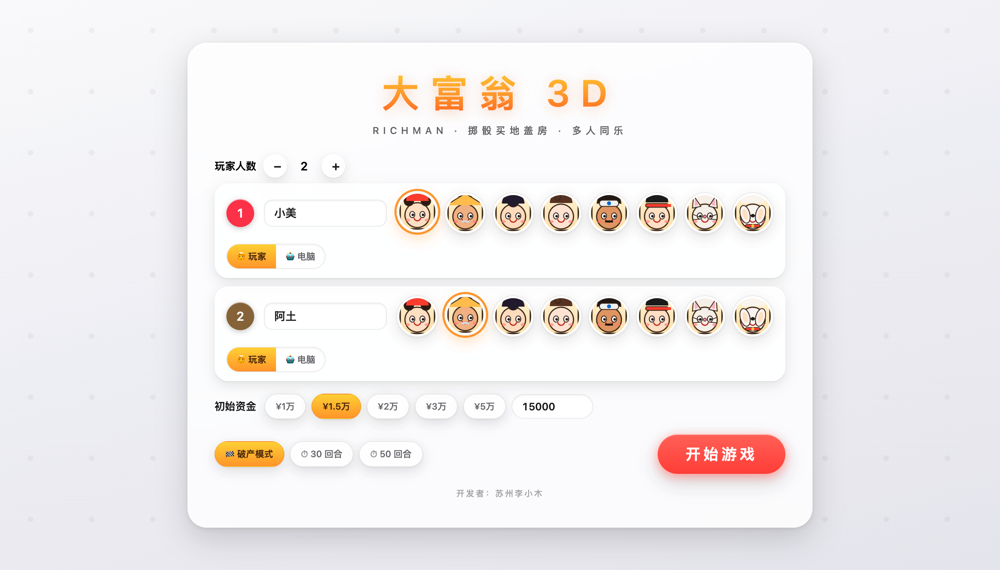
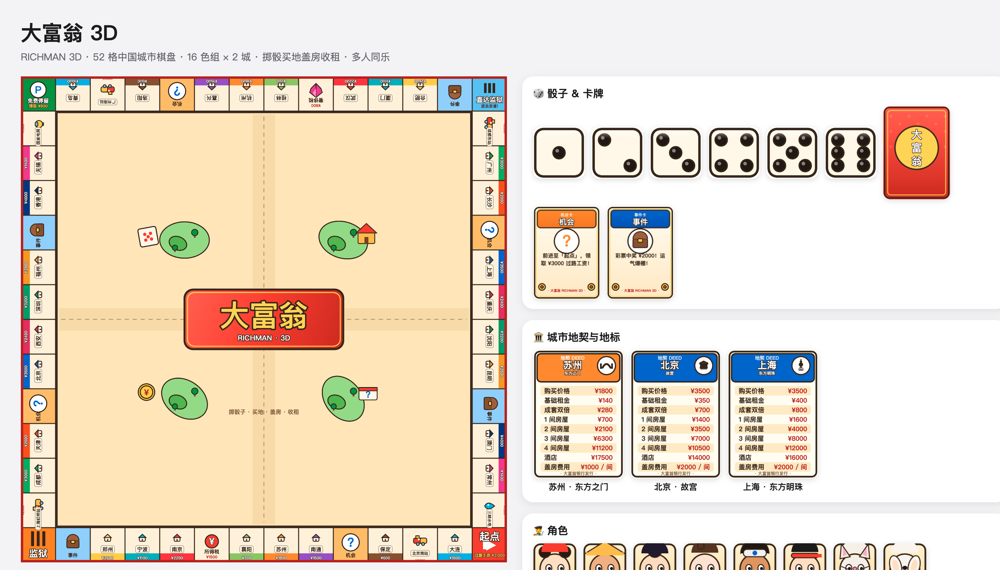
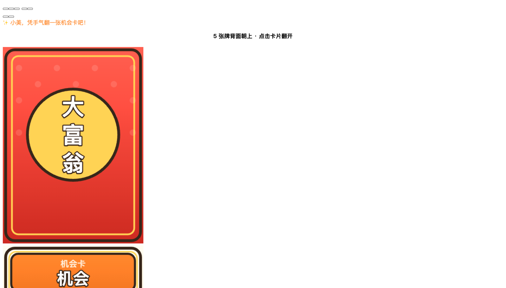

# 🎲 大富翁 3D（Richman 3D）

> 完全复刻经典大富翁核心玩法的 3D 网页游戏：52 格中国城市棋盘，2~4 人同屏对战（支持电脑 AI），掷骰子、买地、盖房、收租、机会/事件翻牌盲选、道具卡——全部图形素材（角色、卡牌、地契、房屋、纸币、地标建筑）均用代码绘制，零外部美术资源。

[](https://richman-3d-sm2cnkoc.edgeone.cool)


## 📸 游戏截图

### 开局设置（自选人数 / 角色 / 初始资金 / 胜利模式）



### 棋盘与素材（52 格 · 16 色组 · 32 城 · 地标地契 · 卡牌 · 纸币）



### 机会 / 事件卡「翻牌盲选」（5 选 1，翻面放大揭晓）



## ✨ 核心玩法

| 系统 | 说明 |
| --- | --- |
| 🎲 回合 | 掷 2 颗骰子定步数；掷出对子再掷一次；连续 3 次对子进监狱；经过/到达起点领 **¥3,000** |
| 🏙 棋盘 | **52 格**环线：32 座中国城市（16 色组 × 2 城）+ 4 车站 + 国家电网/三峡水电 + 机会/事件/税收/监狱 |
| 🏠 地产 | 集齐同色 2 城 → 租金翻倍 + 可盖房（1~4 间 → 酒店）；均匀加盖；出售返还半价；每城带标志性建筑地契（苏州·东方之门、北京·故宫、上海·东方明珠……） |
| 🃏 卡牌 | 机会/事件各 8 张，落格弹出 **5 张背面卡盲选**，翻牌放大揭晓 |
| 🧰 道具 | 遥控骰子、加速卡、免租金牌、出狱卡、路障、劫富卡 |
| 💸 破产 | 现金不足自动半价变卖房屋，仍不足则破产出局 |
| 🏆 胜利 | 破产模式（淘汰至最后一人）或 30/50 回合资产制 |

## 🎮 操作

- 鼠标：旋转 / 缩放棋盘（🎥 按钮可切换「跟随镜头 / 自由镜头」）
- **空格 / 回车** 掷骰子，**Esc** 关闭弹窗
- 悬停格子：高亮；**点击格子**：查看地契与所有人
- 点击左上角玩家头像：查看该玩家的全部地产清单

## 🛠 本地运行

```bash
# 任意静态服务器即可（游戏为纯静态资源）
python3 -m http.server 3090
# 打开 http://127.0.0.1:3090/
```

> 无需构建、无外部依赖：three.js 已内置于 `vendor/`，全部素材运行时用 Canvas/WebGL 代码绘制。

## 🧱 技术栈与结构

```
richman-3d/
├── index.html          # 入口（importmap + HUD 骨架）
├── css/style.css       # 苹果美学主题（毛玻璃 / 胶囊按钮 / 动效）
├── js/
│   ├── config.js       # 棋盘 52 格 / 16 色组 / 卡牌 / 道具 / 角色配置
│   ├── draw.js         # Canvas 卡通素材绘制（棋盘/骰子/卡牌/地契/32 地标/纸币/头像）
│   ├── scene.js        # Three.js 场景（棋盘/角色/房屋/骰子/镜头/粒子动效）
│   ├── game.js         # 规则引擎（回合/买卖/收租/监狱/破产/结算）
│   ├── ui.js           # 界面与弹窗（设置/HUD/翻牌盲选/盖房/地产清单）
│   ├── ai.js           # 电脑玩家决策
│   └── sound.js        # WebAudio 合成音效 + 8-bit 芯片背景乐
├── vendor/             # three.js（MIT）
└── test/               # 冒烟测试与可视化自检页
```

## ✅ 测试

- `node test/smoke.mjs [回合数]` —— 规则引擎无头测试（含破产/清算/自定义资金用例）
- `test/shot.html` / `test/check.html` / `test/pickcard.html` —— 浏览器可视化自检页

## 📄 开源协议

[MIT License](LICENSE) © 2026 苏州李小木

> 开发者：苏州李小木
